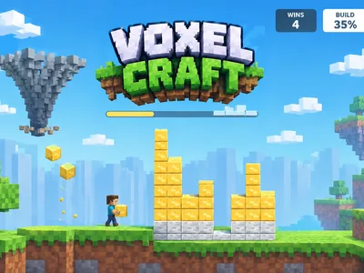
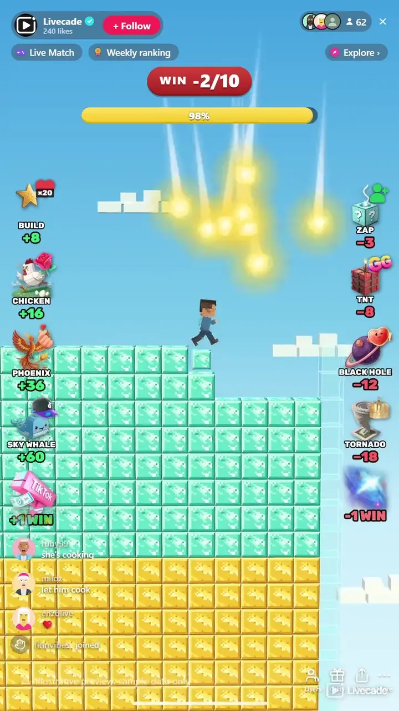

# Voxel Craft - Interactive TikTok Live Game

> You build the wall, your chat decides whether you finish it.

You build a 24 by 24 voxel wall live, block by block, while your chat decides whether you finish it. Heroes fly blocks into the gaps, villains blast them back out, and once the wall is whole it has to survive a countdown to win.

**[Play Voxel Craft on Livecade](https://livecade.io/games/voxel-craft/?utm_source=github&utm_medium=readme&utm_campaign=voxel-craft)** - runs as a single browser source in OBS, Streamlabs, or TikTok LIVE Studio. Nothing for viewers to install.

## How viewers play

Viewers take part with the actions TikTok already gives them: **comments**, **gifts**, **likes**, **follows**, **shares**. Every action below is rebindable, so you decide which interaction drives which effect.

| Action | What it does |
| --- | --- |
| **Build** | Stars fall into the lowest empty cells, 8 blocks by default |
| **Phoenix Architect** | A phoenix flies across the wall dropping 36 blocks as it goes |
| **Chicken** | A chicken runs along the wall laying 16 eggs that hatch into blocks |
| **Sky Whale** | A whale swims over the wall and sprays 60 blocks from its blowhole |
| **Zap** | Lightning strikes the tallest columns, taking 3 blocks by default |
| **TNT** | A stick of dynamite blows 8 blocks out of the wall |
| **Black Hole** | Pulls 12 blocks out one at a time |
| **Tornado** | Sweeps across the top of the wall and carries 18 blocks away |
| **+Win** | A gold trophy lands beside the builder: one free win |
| **-Win** | A raccoon runs in and steals a win, even below zero |

## How it works

### You play it, live

Walk, jump and hold to stack blocks under your feet, straight from the dashboard with keyboard and mouse. The character runs in your own browser, so it responds instantly, and the stream shows the same moves a moment later.

### Four heroes, four villains

Falling stars, a phoenix, a block-laying chicken and a sky whale build; a lightning zap, TNT, a black hole and a tornado break. Each one has its own animation and sound, and each can be bound to any trigger with its own block count.

### Defend what you built

A finished wall has to survive a countdown before it counts. A hit knocks it back to building, and a quick refill picks the countdown up where it stopped.

### Viewers on the blocks

Optionally, every block a viewer sends carries their profile picture, so the finished wall shows who built it.

## About the game

Voxel Craft puts a blocky builder on your stream and a wall of 576 empty cells in front of it. You walk, jump and stack blocks under your own feet to climb, the way you would in any block-building game, and the round is won when every cell is filled and the finished wall survives a short defend countdown. Your viewers never touch the controls. They decide how hard that is.

### Heroes build, villains break

Every trigger in the game is either a hero or a villain. Heroes fill the lowest gaps for you: a shower of falling stars, a phoenix that drops blocks on its way across, a chicken that runs along the wall laying eggs that hatch into blocks, and a sky whale that sprays a whole fountain of them. Villains take blocks away: a zap of lightning on the tallest columns, a stick of TNT, a black hole that rips blocks out one at a time, and a tornado that sweeps across the top of the wall carrying them off.

### Finished is not the same as won

A full wall starts the defend countdown, and a villain that lands a hit during it knocks the round back to building. If the gap is refilled within a few seconds, by you or by blocks already flying in from the bank, the countdown carries on from where it stopped. Leave it longer and the next completion starts the countdown over, so a well-timed villain can genuinely cost you the round and a stocked bank can genuinely save it.

### Wins, a goal, and a trophy at the end

Every defended wall is a win on a counter at the top of the screen, and viewers can move that counter directly too: one gift drops a gold trophy next to you for a free win, another sends a raccoon to steal one, and the count can go below zero. Set a win goal and reaching it ends the game on a trophy stage with fireworks and a New Game button.

## What it looks like on stream

[Watch Voxel Craft gameplay](https://cdn.livecade.io/games/voxel-craft.mp4)

## What you can configure

- **Interface language** - Thirteen languages for everything on screen
- **Builder mode** - Play it yourself with keyboard and mouse, or let the builder play itself
- **Block style** - Iron, gold and diamond tiers as the wall rises, natural dirt and stone, builder blue, or rainbow bands
- **Character** - A boy or a girl builder
- **Viewer photos on blocks** - Blocks a viewer sends show their profile picture
- **Defend time** - Five to thirty seconds the finished wall has to survive
- **Refill time** - One to ten seconds to repair a hit before the defend countdown starts over
- **Win goal** - The wins that end the game on the trophy stage, or 0 to play without one

## Languages

English, Spanish, Portuguese, French, German, Italian, Indonesian, Arabic, Turkish, Russian, Hindi, Romanian, Filipino

## FAQ

<strong>How do viewers play Voxel Craft?</strong>

They send heroes and villains. Out of the box, 20 likes send a Build, a follow sends a Zap, and gifts send the rest, from a Rose for the chicken up to a Galaxy that steals a win. Every action can be rebound to comments, likes, follows, shares or any gift, each with its own block count.

<strong>Do I have to play it myself?</strong>

No. Switch the builder mode to Auto and the character builds on its own, which keeps the stream going while you talk to chat. Switch back to manual at any time.

<strong>Can villains stop me from winning?</strong>

Yes. A villain that breaks the finished wall during the defend countdown sends the round back to building. Refill it within the refill time and the countdown carries on; take longer and the next finished wall has to survive the full countdown again.

<strong>What happens when I reach the win goal?</strong>

The game ends on a trophy stage with fireworks and a New Game button in your dashboard. Gifts sent while it is up are kept: blocks go to the bank and villains wait for the new game.

<strong>How do I add Voxel Craft to my TikTok Live?</strong>

Add one browser source URL to OBS or your streaming software and go live. There is no plugin to install and nothing for your viewers to download. Voxel Craft renders in 3D, so give it a reasonably modern machine.

## Setup

1. [Create a Livecade account](https://app.livecade.io/register?utm_source=github&utm_medium=cta&utm_campaign=voxel-craft)
2. Copy your overlay browser source URL
3. Paste it into OBS, Streamlabs, or TikTok LIVE Studio
4. Pick Voxel Craft, set your triggers, and go live

Runs in the browser, so it works on Windows and macOS with nothing to download. [See all TikTok Live games](https://livecade.io/tiktok-live-games/?utm_source=github&utm_medium=readme&utm_campaign=voxel-craft).

---

_This repository documents Voxel Craft, a hosted interactive game by [Livecade](https://livecade.io/?utm_source=github&utm_medium=footer&utm_campaign=voxel-craft). The game runs on Livecade's platform, so there is no source to install here._
